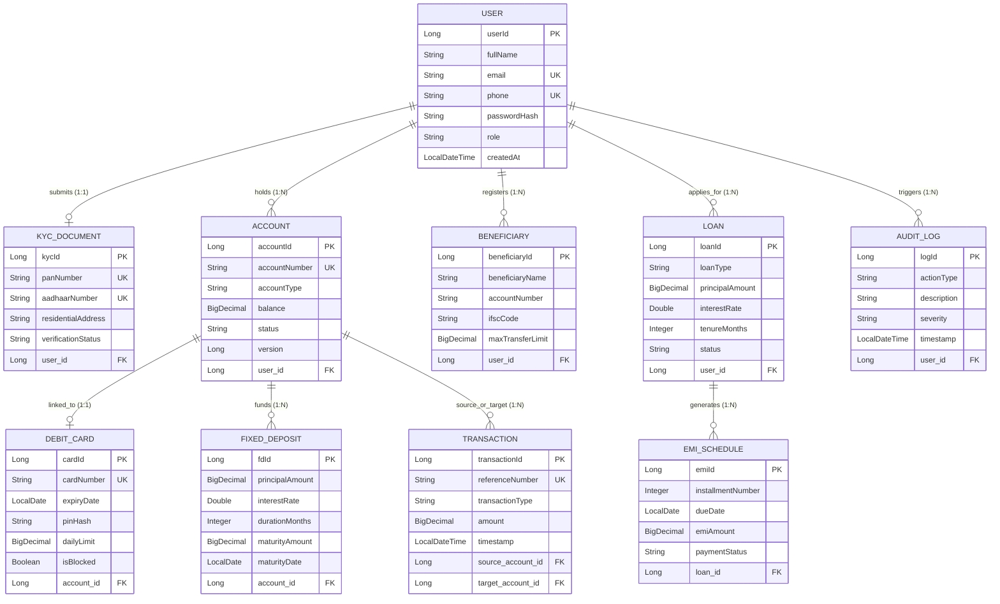

You can generate the complete `README.md` file directly inside your project folder in one click, or copy the raw file content below.

### Option 1: Auto-Create `README.md` via PowerShell (Fastest)

Copy and paste this entire block into your VS Code PowerShell terminal (`E:\My MCA Training\online-banking-hibernate>`). It will automatically create and save the complete `README.md` file in your project root:

```powershell
@'
# 🏦 Enterprise Online Banking System (Hibernate ORM)


An enterprise-grade, **ACID-compliant Core Banking System** built using **Java**, **Hibernate ORM (Jakarta Persistence / JPA)**, and **MySQL**. Designed as a 4-module collaborative architecture covering Customer e-KYC Onboarding, Atomic Fund Transfers with Optimistic Locking, Automated Loan & EMI Scheduling, and Real-Time Card Fraud Detection.

---

## 📌 Key Architectural Highlights

* **Concurrency & Race-Condition Protection (`@Version`):** Implements Hibernate Optimistic Locking on bank accounts to prevent dirty reads and double-spending during simultaneous ATM or online transfers.
* **ACID Transaction Engine:** All debits, credits, and audit ledger entries execute inside atomic Hibernate transaction boundaries (`beginTransaction()` -> `commit()` / `rollback()`).
* **High-Precision Monetary Math:** Uses `java.math.BigDecimal` mapped to SQL `DECIMAL(15,2)` across all financial entities to eliminate floating-point rounding anomalies.
* **Automated Reducing-Balance EMI Scheduler:** Dynamically calculates monthly loan installments and batch-inserts repayment schedules upon loan approval.
* **Rule-Based Fraud Guard:** Automatically flags high-value withdrawals exceeding safety thresholds, blocks compromised debit cards, and records critical security alerts.

---

## 👥 4-Module Team Architecture

The system is architected into **4 independent domain modules** across **10 relational entities**:

| Module | Domain Responsibility | Entities Owned | Core Features |
| :--- | :--- | :--- | :--- |
| **Module 1** | **Customer Onboarding, e-KYC & Multi-Account Engine** | `User`, `KycDocument`, `Account` | `@OneToOne` PAN/Aadhaar KYC verification workflow, Savings/Current account provisioning, Account freeze/unfreeze controls, Role-Based Access (`CUSTOMER`, `MANAGER`, `ADMIN`). |
| **Module 2** | **Core Payment Gateway, Beneficiaries & ACID Ledger** | `Transaction`, `Beneficiary` | `@Version` Optimistic Locking, NEFT/RTGS/IMPS fund transfers, Payee limit enforcement, Double-entry transaction history & mini-statement HQL queries. |
| **Module 3** | **Loan Origination, EMI Scheduler & Fixed Deposits** | `Loan`, `EmiSchedule`, `FixedDeposit` | Automated reducing-balance EMI calculation, Batch generation of monthly installment schedules, FD compound interest & maturity tracking. |
| **Module 4** | **Card Management, Fraud Detection & Security Audit** | `DebitCard`, `AuditLog` | Virtual/Physical Debit Card issuance, SHA-256 PIN hashing, Daily ATM limit enforcement, Automated fraud flagging & card hotlisting. |

---

## 🗂️ Database ER Diagram



---

## 📂 Project Directory Structure

```text
online-banking-hibernate/
├── pom.xml
├── README.md
├── .gitignore
└── src/
    ├── main/
    │   ├── java/com/bank/
    │   │   ├── config/
    │   │   │   └── HibernateUtil.java          # SessionFactory Singleton
    │   │   ├── entity/
    │   │   │   ├── User.java                   # Module 1
    │   │   │   ├── KycDocument.java            # Module 1
    │   │   │   ├── Account.java                # Module 1
    │   │   │   ├── Transaction.java            # Module 2
    │   │   │   ├── Beneficiary.java            # Module 2
    │   │   │   ├── Loan.java                   # Module 3
    │   │   │   ├── EmiSchedule.java            # Module 3
    │   │   │   ├── FixedDeposit.java           # Module 3
    │   │   │   ├── DebitCard.java              # Module 4
    │   │   │   └── AuditLog.java               # Module 4
    │   │   ├── service/
    │   │   │   ├── BankingService.java         # Onboarding & ACID Transfers
    │   │   │   ├── LoanAndDepositService.java  # EMI Engine & FD Service
    │   │   │   └── SecurityAndCardService.java # Fraud Detection & ATM Guard
    │   │   └── App.java                        # Application Entry Point
    │   └── resources/
    │       └── hibernate.cfg.xml               # Database & Entity Config
    └── test/
        └── java/com/bank/
            └── AppTest.java                    # Unit Tests

```

---

## ⚙️ Prerequisites & Local Setup

### 1. System Requirements

* **Java Development Kit (JDK):** Version 17 or 21
* **Database:** MySQL Server 8.0+
* **Build Tool:** Apache Maven 3.8+
* **IDE:** VS Code / IntelliJ IDEA / Eclipse

### 2. Clone the Repository

```bash
git clone [https://github.com/your-username/online-banking-hibernate.git](https://github.com/your-username/online-banking-hibernate.git)
cd online-banking-hibernate

```

### 3. Configure MySQL Database

1. Start your local MySQL server.
2. Open `src/main/resources/hibernate.cfg.xml` and update the credentials for your local database:

```xml
<property name="connection.url">jdbc:mysql://localhost:3306/online_banking_db?createDatabaseIfNotExist=true</property>
<property name="connection.username">root</property>
<property name="connection.password">YOUR_LOCAL_MYSQL_PASSWORD</property>

```

> **Note:** With `<property name="hbm2ddl.auto">update</property>` enabled, Hibernate automatically creates the `online_banking_db` database and all 10 tables on first run.

### 4. Build and Run

```bash
# Compile and download dependencies
mvn clean install

# Execute the main application
mvn exec:java -Dexec.mainClass="com.bank.App"

```

---

## 🧮 Core Financial Formulas Implemented

* **Reducing-Balance Loan EMI Formula (`LoanAndDepositService.java`):**
`EMI = [P x r x (1 + r)^n] / [(1 + r)^n - 1]`
* **P**: Principal Loan Amount (`BigDecimal`)
* **r**: Monthly Interest Rate (`Annual Rate / 12 / 100`)
* **n**: Loan Tenure in Months


---

## 🔒 Security Best Practices

* **Credential Safety:** Never commit real database passwords or secret keys. Use `.gitignore` to exclude `.env`, `target/`, and IDE metadata files (`.vscode/`, `.idea/`).
* **SQL Injection Prevention:** All database queries use parameterized HQL (`setParameter()`) via Hibernate `Session`.

---

## 🤝 Project Contributors (MCA Major Project)

* **Member 1** – *Customer Onboarding, e-KYC & Multi-Account Engine*
* **Member 2** – *Core Payment Gateway, Beneficiaries & ACID Ledger*
* **Member 3** – *Loan Origination, EMI Scheduler & Fixed Deposits*
* **Member 4** – *Card Management, Fraud Detection & Security Audit*

---

## 📄 License

Developed for academic and educational purposes under the **MIT License**.
'@ | Set-Content -Path README.md -Encoding UTF8

```

---

### Option 2: Push the Newly Created `README.md` to GitHub
Right after running the block above, run these three commands in your terminal to push `README.md` to your live GitHub repo:

```powershell
git add README.md
git commit -m "docs: add comprehensive project README with ER diagram and 4-module breakdown"
git push origin main

```
